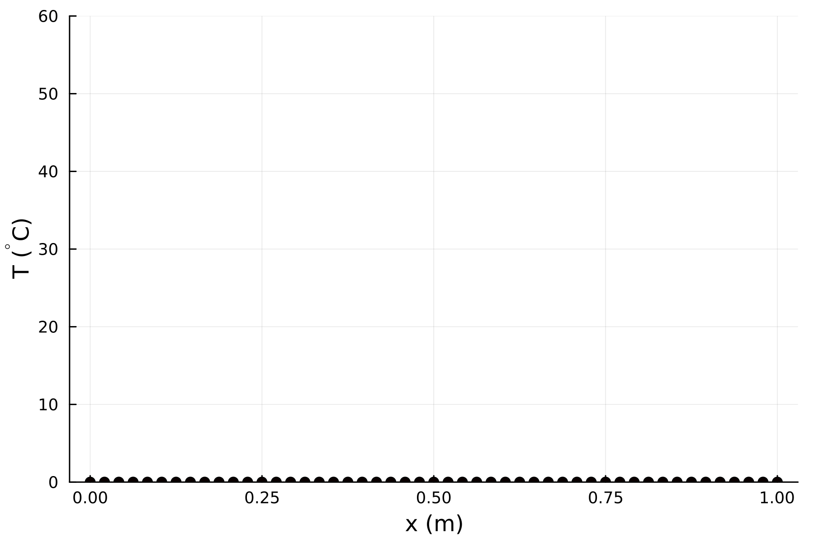
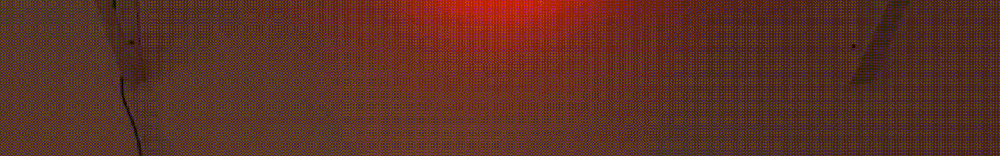
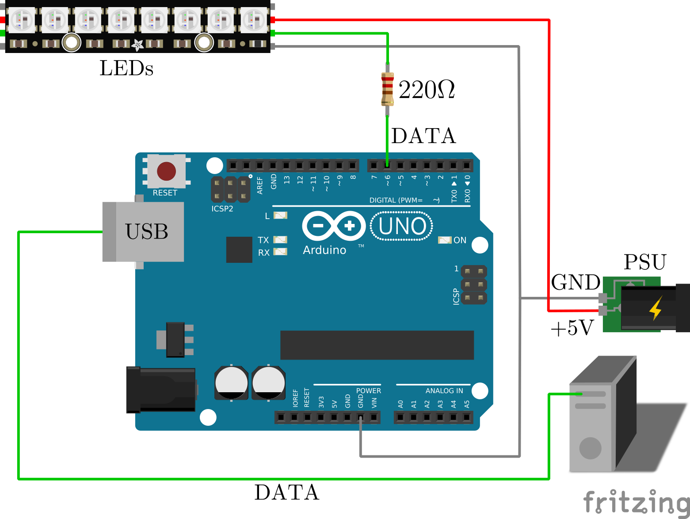
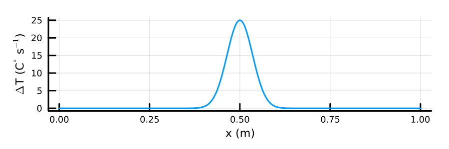
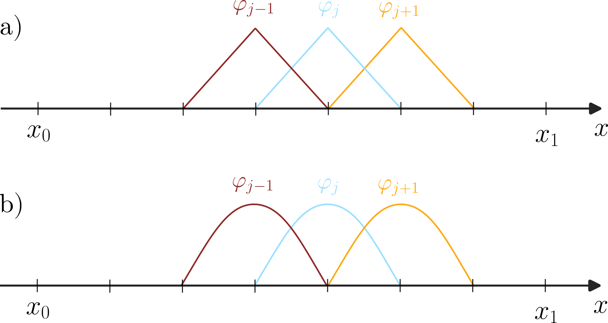

# Heat-Diffusion-LED (WIP)

This is a program simulating in real time how heat diffuses on a thin rod, displayed using addressable RGBs.

For running the program, the following hardware components are required:
* An Arduino microcontroller, e.g., Arduino UNO
* An addressable LED strip, e.g., WS2812B
* A +5V DC power supply for powering the LEDs
* A 220 $$\Omega$$ resistor (optional but recommended)
* A soldering iron (depending on the LEDs)

The power supply can either be external, or if on a work station you can use its Power Supply Unit (PSU). The power supply should the very least be able to deliver a current of 2 A or above. Recommended is 5 A or above, depending on the type and the number of LEDs, of course. Typically 60 mA per LED is needed, but your milage may vary.

## Demonstration
Below is a video demonstration using the colormap [hot](https://matplotlib.org/stable/users/explain/colors/colormaps.html) from [Matplotlib](https://matplotlib.org).




## Installation instructions

### Software
#### Host
The host running the program needs a C compiler and standard build tools. On Debian-based distros
these can usually be installed by running the command

```sh
sudo apt install gcc build-essential
```

The program also makes use of the development packages of the following external libraries:

* [GNU Scientific Library](https://www.gnu.org/software/gsl) for dense linear algebra
* [Suitesparse](https://github.com/DrTimothyAldenDavis/SuiteSparse) for sparse linear algebra
* [cJSON](https://github.com/DaveGamble/cJSON) for parsing the configuration file

These can libraries can be installed via
```sh
sudo apt install libsuitesparse-dev libgsl-dev libcjson-dev
```

If using a different distro, consult your package manager for the specific packages.

Once dependencies are installed, clone the repo:
```sh
git clone https://github.com/andrelofgren/Heat-Diffusion-LED.git
```

Then to compile, change into the cloned directory and type
```sh
cd Heat-Diffusion-LED && make install
```
which will install the binary ```heat_diffusion``` into the ```bin``` directory.

#### Microcontroller
The Arduino firmware file ```firmware/firmware.ino``` makes use of the [FastLED](https://fastled.io) library to control the LEDs. Before attempting to upload the firmware, first ensure that you have setup the arduino-cli properly, see this [link](https://docs.arduino.cc/arduino-cli) for instructions on how this is done. Secondly, make sure that the port name and board name in ```firmware/sketch.yaml``` is correct. If using a different board from the Arduino Uno, the board name has to be changed. Lastly, the number of LEDs needs to be specified in the ```firmware/firmare.ino``` file. This is done by changing the number 49 to the number of LEDs in your strip in the line that reads
```c
#define NUM_LEDS 49
```

Once you have ensured that the arduino-cli program has been setup properly, the FastLED library can be installed by invoking
```sh
arduino-cli lib install FastLED
```

After the command has finished the firmware is ready to be compiled and uploaded. To this end, connect a usb cable between the host computer and the Arduino, and then simply type
```sh
make upload
```
which compile the program and upload it to the microcontroller.

Alternatively, the above procedure of installing the FastLED library and uploading the firmware can be done using the Arduino IDE.
### Microcontroller setup


The wiring I use is shown in the above figure. The setup is as follows:

1. Connect the PWM PIN 6 to the data channel on the RGB list.
2. Optionally, solder on a 220 $$\Omega$$ resistor in between.
3. Connect the Arduino, PSU, and LED strip to ground.
4. Connect the +5V PSU pin to the LED strip positive pin.
5. Connect a usb cable between the arduino and the host.

Relevant configuration parameters in ```config.json```:
```json
"serial": {
    "device": "/dev/ttyACM0",
    "baud_rate": 115200
}
```

Ensure that the device path is correct.

## Running the program
With the wiring in place, we now just need to set number of LEDs in the configuration file ```config.json```. The program can then be run by typing
```sh
bin/heat_diffusion config.json
```

The configuration file may also be stored under ~/.local/heat_diffusion/config.json which is the path the program looks for the config file if not specified.

Relevant configuration parameters in ```config.json```:
```json
{
    "num_leds": 49,
}
```
This should be changed to the number of LEDs in your strip.

## Colormaps
The script supports all default colormaps of the Matplotlib Python plotting library. To set a specific colormap to be used, first install matplotlib (either via distro package manager or pip), and then run
```sh
python script/set_color_from_cmap.py name_of_colormap
```

Available colormaps can found by running
```sh
python script/set_color_from_cmap.py --list-cmaps
```

Additional colormaps not included by default in matplotlib can be installed via pip by running
```sh
pip install cmasher cmocean sciviz
```

Relevant configuration parameters in ```config.json```:
```json
 "colormap": {
     "num_bins": 15,
     "color_1": [
         0.11775297,
         0.79927839,
         0.75066449
     ],
     "color_2": [
         0.11775297,
         0.79927839,
         0.75066449
     ],
     ...
     "color_15": [
         0.16377781,
         0.69908326,
         0.77416406
     ],
```

Here the field ```color_1``` corresponds to the RGB value for the minimum temperature, and the field ```color_15``` the maximum. The number of colors are set by the field num_bins. This part of the config file is autogenerated when running the Python script above.

## The model
The heat conduction is modeled using the one dimensional heat equation to solve for the temperature $$T$$, on the spatial domain $$\Omega = [x_0, x_1]$$ over a time interval $$[t_0, t_1]$$:

$$\frac{\partial T}{\partial t} = \alpha \nabla^2 T - \beta \frac{\partial T}{\partial x} - \gamma T + q(x, t), \quad (x, t) \in \Omega \times [t_0, t_1]$$.

In this model the instaneous change in temperature, represented by the left-hand side term, at a particular point $x$ has four contribution: The first term on the right-hand side (RHS) is the change in temperature due to diffusion, with $$\alpha$$ being the diffusion coefficient. The second term on the RHS is the temperature change due to advection, with $$\beta$$ being the advection velocity. The third term models the heat exchange with the surrounding air, with $$\gamma$$ being the thermal conductivity between the air and the rod. Lastly $$q$$ is a forcing term representing an external source heating the rod. This could for example be the lit match, shown in the figure above, but can in theory be any process capable of generating heat such as radioactive decay.

For boundary conditions insulated ends are used:

$$\frac{\partial T}{\partial x} = 0, \quad x=x_0$$ or $$x=x_1$$,

meaning no heat is allowed to escape through the boundary.

The initial temperature is set to $$T=0$$.

Relevant configuration parameters in ```config.json```:
```json
"domain": {
    "x0": 0.0,
    "x1": 1.0,
    "t0": 0.0,
    "t1": 15.0
},
"material": {
    "alpha": 0.05,
    "beta": 0.0,
    "gamma": 0.2
}
```

## The source term

To force the model we use a heat source term in the form of a gaussian with an exponentialy decaying amplitude:

$$q(x, t) = \frac{A_0}{\sqrt{2 \pi} \sigma} \exp\left({\frac{t-t_0}{\tau}}\right) \exp\left({\frac{(x-\mu)^2}{4 \sigma^2}}\right)$$.

Here $$A_0$$ is the initial amplitude, $$\tau$$ a relaxation term, $$\mu$$ is the center of the gaussian, and $$\sigma$$ its standard deviation. The function is shown at time $$t = t_0$$ in the above figure for the indicated parameter values in the config file below.

Relevant configuration parameters in ```config.json```:
```json
"source": {
    "A0": 25.0,
    "sigma": 0.025,
    "mu": 0.5,
    "tau": 4.0
}
```

### Spatial discretization


The problem is solved numerically using the finite element method (FEM). To discretizate one first has to define the space of possible solutions (the so-called trial space) $$\mathcal{U}$$, so that $$T \in \mathcal{U}$$. Next we multiply by a test function $$v \in \mathcal{V}$$, where $$\mathcal{V}$$ is the space of test functions (the so-called test space), and integratining over the domain. This leads to the time-continuous weak formulation of the problem: Find $$T \in \mathcal{U}$$ such that:

$$\left(v, \frac{\partial T}{\partial t} \right)_{\Omega} = \left(v, \frac{\partial T}{\partial t} \right)$$,

where

$$ \left(v, u \right) = \int_{\Omega} v u d \Omega $$

denotes an inner product between functions $$v$$ and $$u$$.

With the weak form in place, the finite element discretization can now be performed by restricting trial- and test spaces to functions that are piecewise polynomial over each element of the discretized domain. These spaces we denote by $$\mathcal{U}_h$$ and $$\mathcal{V}_h$$, respectively. To discretize the PDE we then make use of the fact that any function $$u \in \mathcal{U}_h$$ can be written as a linear combination:

$$T(x, t) = \sum_{j=1}^{n} u_j(t) \varphi_j(x)$$,

with spatial derivative:

$$\frac{\partial T}{\partial x} = \sum_{j=1}^{n} u_j(t) \frac{d \varphi}{dx}$$.

Here $$\varphi_j$$ is a polynomial of arbitrary order centered on the node with index $$j$$. Order 1 (linear) and order 2 (quadratic) polynomials are shown in the figure above.

Inserting the expression for $$T$$ into the above weak form and letting $$v = \varphi_i(x)$$, we for each $$i \in \{1,...,n\}$$, where $$n$$ is the number of degrees of freedoms, obtain the following ordinary differential equations:

$$\sum_{j=1}^{n} \frac{d u_j}{dt} \left (\varphi_i, \varphi_j \right)_{\Omega} = -\alpha \sum_{j=1}^{n} \left(\frac{d \varphi_i}{dx}, \frac{d \varphi_j}{dx} \right)_{\Omega} u_j - \beta \sum_{j=1}^{n} \left(\varphi_i, \frac{d\varphi_j}{dx} \right )_{\Omega} u_j - \gamma \sum_{j=1}^{n} \left(\varphi_i, \varphi_j \right)_{\Omega} u_j + \left(\varphi_i, q(x, t) \right)_{\Omega}$$

Defining the following the following matrices and vector with elements given by:

$$M_{ij} = (\varphi_i, \varphi_j)_{\Omega}$$,

$$A_{ij} = (\frac{d \varphi_i}{dx}, \frac{d\varphi_j}{dx})_{\Omega}$$,

$$S_{ij} = (\varphi_i, \frac{d\varphi_j}{dx})_{\Omega}$$,

$$f_i = (\varphi_i, q(x, t))_{\Omega}$$,

the system can be written more compactly as:

$$M\frac{d\mathbf{u}}{dt} = -\alpha A \mathbf{u} - \beta S \mathbf{u} - \gamma M \mathbf{u} + \mathbf{f}$$.

### Temporal discretization
To discretize in time we use the Crank-Nicolson (CN) discretization. This method is highly efficient as it is second order accurate w.r.t. to the time-step size $$\Delta t$$ and unconditionally stable.

Applying the CN discretization we obtain

$$M\frac{\mathbf{u}^{k+1} - \mathbf{u}^{k}}{\Delta t} = -\alpha A \frac{\mathbf{u}^{k+1} + \mathbf{u}^{k}}{2} - \beta S \frac{\mathbf{u}^{k+1} + \mathbf{u}^{k}}{2} - \gamma M \frac{\mathbf{u}^{k+1} + \mathbf{u}^{k}}{2} + \frac{\mathbf{f}^{k+1} + \mathbf{f}^k}{2}$$,

where $k$ denots the time step. Rearranging terms we then arrive at the following linear system for the unknown temperature coefficients, $$\mathbf{u}^{k+1}$$, at time step $k+1$

$$\left ( \left ( 1 + \frac{\gamma \Delta t}{2} \right) M + \frac{\alpha \Delta t}{2} A + \frac{\beta \Delta t}{2} S \right ) \mathbf{u}^{k+1} = \left ( \left ( 1 - \frac{\gamma \Delta t}{2} \right) M - \frac{\alpha \Delta t}{2} A - \frac{\beta \Delta t}{2} S \right ) \mathbf{u}^k + \Delta t \frac{\mathbf{f}^{k+1} + \mathbf{f}^k}{2}$$.

Defining $$L = \left ( 1 + \frac{\gamma \Delta t}{2} \right) M + \frac{\alpha \Delta t}{2} A + \frac{\beta \Delta t}{2} S$$ and $$R=\left ( 1 - \frac{\gamma \Delta t}{2} \right) M - \frac{\alpha \Delta t}{2} A - \frac{\beta \Delta t}{2} S$$, the system can be written as

$$L \mathbf{u}^{k+1} = R \mathbf{u}^k + \frac{\Delta t}{2} \left ( \mathbf{f}^{k+1} + \mathbf{f}^{k} \right )$$.

Because the matrix $$L$$ is time independent, it only needs to be inverted once for the whole simulation. The solution procedure is summarized by the following (pseudo) C algorithm:

```C
Vector run_simulation(const double t0, const double t1, const size_t nt)
{
    const double dt = (t1 - t0)/nt;

    const Matrix L = assemble_lhs_mat(dt);
    const Matrix L_inv = Matrix_invert(L);
    const Matrix R = assemble_rhs_mat(dt);
    Vector u0 = 0;

    double t = t0;
    for (size_t step = 0; step < num_time_steps; step++) {
        Vector f0 = assemble_rhs_vec(t)
        Vector f1 = assemble_rhs_vec(t+dt)
        Vector f = 0.5*dt*(f1 + f0);
        Vector u = L_inv*R*u0 + L_inv*f;

        u0 = u;
        t += dt;
    }

    return u;
}
```

Note for efficiency reasons that in the actual code the inverse is never formed explicitly, rather it relies on its (sparse) LU factorization to calculate its action when applied to vectors and matrices.

Relevant configuration parameters in ```config.json```:
```json
"computational": {
    "nx": 100,
    "nt": 6000,
    "deg": 3,
    "update_after_num_steps": 10,
    "repeat_num_times": -1
}
```
Note that -1 means repeat simulation, by all practical means, indefintely.

## License
All code-related files are released under MIT license, while all media (found in the assets directory) under Creative Commons license CC-BY-4.0. Please see the respective LICENSE files for terms of use.
